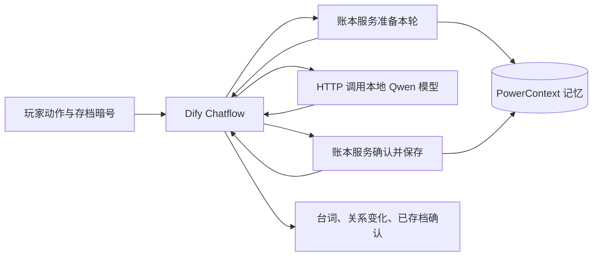

# 嘴硬掌柜：这笔账我记下了

青石镇的雨下个不停。小卖部掌柜沈不服嘴上说“不认识你”，却记得你上次拿走了他的蓝伞。
玩家可以惹事、还伞、赔礼或修门，改变关系并解锁隐藏结局。**换一个 Dify 会话，使用相同存档暗号回来，掌柜仍会翻旧账。**

入口采用 Dify 自带聊天页面，无需独立前端。

完整真实对话、节点记录和页面截图见 [运行证据](evidence/README.md)。

## 提交文件

| 文件 | 用途 |
| --- | --- |
| `dsl/npc-chatflow.yml` | 唯一应用 DSL，导入为 Chatflow |
| `compose.yaml`、`deploy/` | PowerContext、游戏服务、模型及 Dify 部署配置 |
| `backend/` | 规则与记忆适配服务的完整源码和依赖 |
| `scripts/` | 初始化、导入发布和验证脚本 |
| `VALIDATION.md` | 可重置的验收步骤与预期行为 |
| `evidence/` | 实际运行证据；组件验证与完整 Dify 验证分别标注 |

## 技术分工



- **Dify 1.18.0**：接收输入、组织请求、读取旧账、调用模型、触发存档、输出结果。模型调用直接使用 HTTP Request 节点，因此没有额外模型插件安装或模型供应商密钥。
- **PowerContext 1.4.1**：每个存档暗号建立独立 Scope，事件、关系与物品状态通过真实 HTTP API 写入 Atomic Memory；新会话及服务重启后重新读取。账本的持久化唯一来源是 PowerContext，后端进程内只保存未提交回合。
- **游戏服务 1.0.0**：把确定的动作转成规则结果；模型不能修改数值、发放物品或跨玩家选择 Scope。同一回合重复提交不会重复记账，并发旧回合不能覆盖新状态。
- **Ollama 0.40.11 / Qwen3 1.7B**：生成掌柜的中文台词，关闭思考模式以直接回应玩家。默认模型下载量约 1.4 GB，不需要付费 API Key。小模型仍可能出现措辞偏差，可通过 `MODEL_NAME` 替换为已下载的更强模型；物品、关系与奖励以程序确认的状态为准。

本作品选择 **Dify + PowerContext**；不使用 seekdb、知识库、Embedding、Rerank 或自定义插件。PowerContext 的底层 SQLite 是其持久化实现，不把 SQLite 声称为 seekdb。使用的是显式记忆保存与读取，不声称启用了自动语义记忆提炼。

Dify 将可靠账本事实放入系统上下文，并为首次赠券附加当轮回应提醒。玩家原始输入和实际模型消息分别记录在运行证据中。台词由模型生成，动作、关系和奖励由规则确认。

## 环境与启动

已声明的运行目标：Linux x86_64 / WSL2、Python 3.12、Docker Engine 27+、Docker Compose 2.24.4+。建议至少 8 GB 可用内存，Docker 数据所在宿主机磁盘至少预留 30 GB；首次需要下载多个镜像及模型，时间由网络决定。

本目录中的实际验收记录采用下方的 CPU 构建选项，详细运行版本和模型摘要见 [environment.json](evidence/environment.json)。

WSL 的 `df` 显示的是虚拟磁盘容量，不能代表 Windows 宿主盘仍有空间。即使仓库在 E 盘，Docker 所在 WSL 的 VHD 也可能在 C 盘。初始化脚本会检查这块宿主盘；使用 Docker Desktop 或远程 Docker 时，还需确认实际引擎数据目录的宿主盘余量。

在仓库根目录执行：

```bash
python3 dify/scripts/bootstrap.py up
docker compose --env-file dify/.env -f dify/compose.yaml exec -T --interactive=false game \
  python scripts/provision.py
```

上述命令会：

1. 下载固定版本 Dify 1.18.0 的官方 Docker 部署文件到被 Git 忽略的 `.dify-dev/`。
2. 生成本地 `dify/.env`，使用随机游戏令牌、PowerContext 令牌和管理员密码。
3. 以独立项目 `ob-npc`、`ob-dify-npc` 启动服务。Dify PostgreSQL、应用存储和 PowerContext 都使用 Docker 命名卷，避免依赖作者已有数据库。
4. 下载 `qwen3:1.7b`；导入交付的 DSL，并在内存中填入本地生成的游戏令牌，然后发布应用。

导入脚本成功后会输出聊天页面地址，通常为 `http://localhost:18090/chat/<应用代码>`。
配套部署的宿主机端口均绑定 `127.0.0.1`，供本机体验。
编辑入口是 `http://localhost:18090/apps`；管理员邮箱及密码在本地 `dify/.env`，默认邮箱为 `npc-demo@example.com`。
应用 API Key 和导入结果保存在被忽略的 `dify/.runtime/app.json`，不属于提交文件。

### Windows + WSL 中保持演示运行

使用 WSL 的 systemd 运行 Docker 时，后台服务本身不会保持发行版持续活跃，见[微软说明](https://learn.microsoft.com/en-us/windows/wsl/systemd)。启动应用后，在仓库根目录的 PowerShell 中运行：

```powershell
.\dify\scripts\keep-wsl-alive.ps1 -Distro Ubuntu
```

将 `Ubuntu` 换成实际运行 Docker 的发行版名。脚本用隐藏窗口维持一个前台 WSL 会话，每 10 秒检查本作品的两个 Docker 项目；按下面的停止命令关闭本作品后，它会自动退出。日志在被忽略的 `.dify-dev/wsl-keepalive.*` 中。普通 Linux 部署不需要此步骤。

### 已有 Dify 时手动导入

1. 先运行 `python3 dify/scripts/bootstrap.py prepare` 生成本地凭据，再启动 `compose.yaml` 中的游戏、PowerContext 和模型服务并下载模型。
2. 在 Dify 选择“导入 DSL 文件”，导入 `dsl/npc-chatflow.yml`。
3. 设置 DSL 的环境变量：

| 变量 | 配置 |
| --- | --- |
| `GAME_API_URL` | Dify 服务器可访问的游戏服务地址；配套 Docker 网络中为 `http://npc-game:8090` |
| `GAME_TOKEN` | Secret 类型，填本地 `.env` 中的同名值 |
| `OLLAMA_URL` | 配套网络为 `http://npc-model:11434`，或你的可访问模型地址 |
| `MODEL_NAME` | 已下载的 Ollama 模型名，默认为 `qwen3:1.7b` |

4. 同机 Docker 部署时，将 Dify 的 API、Worker、SSRF 代理加入 `ob-npc-net`，或填写这些容器实际可访问的服务地址。若 Dify 在另一台机器或云端，需部署可达的地址并配置认证。配套自动部署已配置共享网络与私网允许范围。
5. 发布应用后执行下面的验证样例。

### 网络与首次下载

部署需要访问 GitHub/codeload、PyPI、Docker Hub 和 Ollama 模型仓库。只在导入后的运行阶段访问配套服务内部地址，无额外云 API 依赖。

如果 Docker 守护进程不能直连镜像仓库，但终端已有可用代理，可选用：

```bash
python3 dify/scripts/fetch_images.py
export DOCKER_CONFIG="$PWD/.dify-dev/docker-config"
python3 dify/scripts/bootstrap.py up
```

辅助脚本从 Docker Hub 官方 API 取得目标平台摘要，再从缓存或原仓库下载该精确内容并导入，不修改 Docker 守护进程配置。工具来自 Google `go-containerregistry v0.22.1`，下载时校验官方发布校验和。实际镜像摘要保存在本地 `.dify-dev/image-lock*.json`。

### 可选：仅构建 CPU 推理运行库

官方 Ollama 完整镜像包含 GPU 库。若下载太慢，可在 Ubuntu 24.04 / x86_64 上安装 `cmake`（3.24+）、`g++`、`make`、`git`、`patch` 后改用：

```bash
python3 dify/scripts/fetch_images.py --skip-model
export DOCKER_CONFIG="$PWD/.dify-dev/docker-config"
python3 dify/scripts/build_cpu_model.py
python3 dify/scripts/bootstrap.py up
```

此路径保留 Ollama 0.40.11 官方可执行文件，按其官方 CPU 构建方式编译指定的 llama.cpp `b11845`，不包含 GPU 库。源码归档及官方二进制镜像层均校验固定 SHA-256；脚本会构建 `ob-npc-ollama-cpu:0.40.11` 并把选择写入本地 `.env` 的 `OLLAMA_IMAGE`。首次需要访问 codeload、Google 镜像缓存和 Debian 软件仓库，构建结果与模型权重不提交到 Git。此选项只影响推理服务的打包，DSL 与 PowerContext 流程相同。

## 操作与验证

聊天页面先填一个 4—48 位字母、数字、下划线或连字符组成的存档暗号，大小写敏感。例如 `judge-rain-001`；不同玩家使用不同暗号。暗号代表本演示的存档入口，不是带账号认证的生产级多租户身份系统。

支持动作：`偷拿蓝伞`、`归还蓝伞`、`道歉`、`送奶茶`、`帮忙修门`、`查看旧账`、`/重开`。其他输入用于自由聊天，不隐式改变物品或关系。每次成功存档后会显示真实状态。

完整样例见 [VALIDATION.md](VALIDATION.md)。自动验证：

```bash
docker compose --env-file dify/.env -f dify/compose.yaml exec -T --interactive=false game \
  python scripts/verify_app.py
python3 dify/scripts/verify_restart.py
```

单独验证真实 PowerContext 读写：

```bash
docker compose --env-file dify/.env -f dify/compose.yaml exec -T --interactive=false game \
  python scripts/verify_memory.py
```

这个组件验证使用明确标注的固定台词，不等同于 Dify 或模型端到端运行。自动化结果先写入 `.runtime/`，经脱敏后再归档为提交证据。

完整验证及重启检查通过后，可运行 `python3 dify/scripts/collect_evidence.py`，从本地 Dify 数据库读取对应的节点执行状态，归档白名单字段、真实对话和记忆引用。脚本不会归档环境文件、管理员密码、游戏令牌或应用 API Key。

## 异常与限制

- 模型失败或返回空台词时，本轮不会提交。记忆未确认写入时不会显示“已存档”。临时写入超时可用相同回合 ID 重试；并发冲突会提示重新输入。
- `/重开` 开启新章，当前互动不再引用上一章旧账，旧章事件保留用于审计。验收也可用新的暗号恢复全空存档。
- 后端部署为单进程，使用每玩家锁防止并发覆盖；若扩展多实例，需要补充分布式并发控制。演示支持单个存档最多读取 2000 条事件。
- 模型容器默认限制为 3 GB 内存；更换更大的模型时，需要同时调整 `compose.yaml` 的 `model.mem_limit` 并提供足够的宿主机资源。
- 账本服务使用固定动作指令决定状态，自由聊天由模型发挥；不声称任意自然语言都能可靠改变游戏规则。
- 停止服务可运行 `python3 dify/scripts/bootstrap.py stop`，下次启动仍保留数据。脚本不会清理命名卷。

## 来源与许可

玩法、游戏后端、DSL 和验证脚本为本作品实现，未复制题面列举的娱乐工作流。第三方组件遵守各自许可：

- [Dify 官方部署与 DSL 示例，1.18.0](https://github.com/langgenius/dify/tree/1.18.0)，运行配置复用官方 Docker 文件，配置本作品需要的 Chatflow 服务依赖、网络、端口、存储与 Nginx 路由。其他 Dify 功能需按官方部署补齐相应服务。
- [PowerContext 1.4.1](https://github.com/oceanbase/powercontext/tree/powercontext-v1.4.1)，使用 `/v1/scopes`、`/v1/atomic-memory/list`、`/v1/memory/remember`。
- [Ollama 0.40.11 构建说明](https://github.com/ollama/ollama/blob/v0.40.11/docs/development.md)、[llama.cpp b11845](https://github.com/ggml-org/llama.cpp/tree/b11845)、[Qwen3 1.7B](https://ollama.com/library/qwen3:1.7b)。可选 CPU 打包使用官方构建入口；模型权重由官方仓库初始化，不直接打包进 Git。
- [go-containerregistry](https://github.com/google/go-containerregistry)，仅作为网络受限环境中的可选镜像下载工具。
