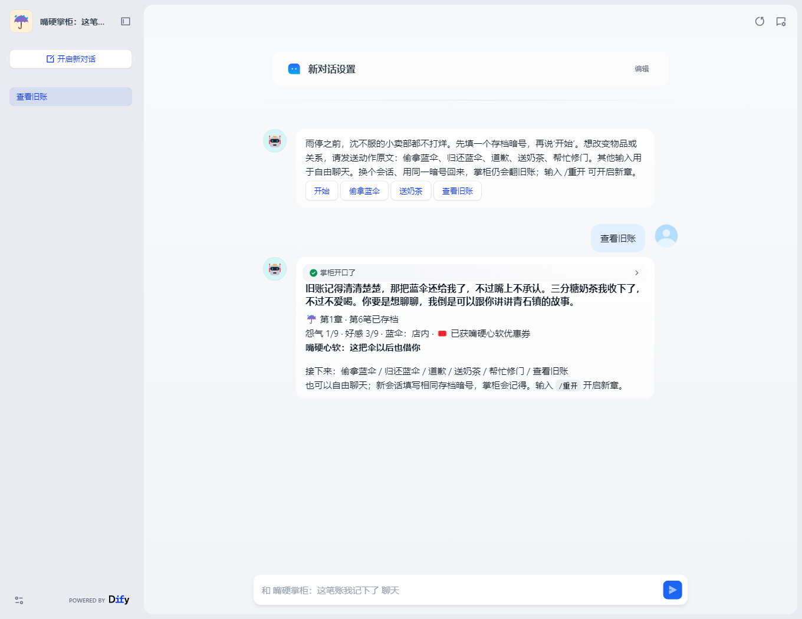

# 实际运行证据

本目录记录真实运行结果。主验收使用 Dify 1.18.0、PowerContext 1.4.1、Ollama 0.40.11 和 `qwen3:1.7b`，在 Windows + WSL2 / Linux x86_64 上运行。实际采用 `build_cpu_model.py` 的 CPU 构建路径；模型摘要、镜像 ID 和核心源码校验值见 `environment.json`。没有使用付费模型密钥。

| 文件 | 验证内容 |
| --- | --- |
| `dify-verification.json` | 5 步真实发布应用调用，以及故障、重启和重启后的新会话结果 |
| `dify-node-executions.json` | 上述 6 次实际 Dify 运行的 54 个成功节点；保留旧账引用、交给模型的上下文和确认存档结果 |
| `transcript.md` | 上述调用的实际模型对白及状态栏，便于直接阅读 |
| `environment.json` | 实际软件版本、模型摘要、镜像 ID、CPU 构建标记与核心文件 SHA-256 |
| `browser-verification.json` | 通过 Dify 原生聊天页面另开会话，使用相同暗号；页面回复与新写入的记忆一致 |
| `chat-opening.png`、`chat-play.png` | 真实浏览器截图，分别展示存档表单和继续旧存档的对话 |
| `memory-integration.json` | 独立的真实 PowerContext API 检查：新会话读取、重复提交和玩家隔离；明确使用固定测试台词，不算模型运行 |
| `migration-persistence.json` | 完整关闭并重新启动 WSL 后，原 Scope、记忆引用与状态仍能读回 |
| `model-unavailable.json` | 独立异常检查：模型不可用时，Dify 停在存档节点之前，没有伪造回合 |
| `unit-tests.txt` | 10 项规则与一致性测试的输出；此类单元测试使用内存替身，与真实组件证据区分 |

主样例依次执行：偷拿蓝伞 → 新会话查看旧账 → 归还蓝伞 → 送奶茶并解锁优惠券 → 不同玩家初见。随后暂时停掉记忆服务，确认返回 `503` 和 `saved=false`；重启服务后比较完整账本，并再开 Dify 会话继续互动。

浏览器检查在主样例之后，继续同一个存档，因此会比主 JSON 中的重启检查再多一笔“查看旧账”记录。它是额外的真实会话，不计入前述 6 次 API 运行的节点数量。

节点记录同时保留玩家原始输入和实际交给模型的消息。系统上下文与首次赠券提醒来自已读取的账本及规则结果；NPC 台词由本地模型生成。状态与奖励由程序确认，输出措辞不要求逐字复现。各次独立检查的任务、玩家与会话标识可以不同，时间均按文件中的 UTC 字段核对。

## 实际聊天页面

